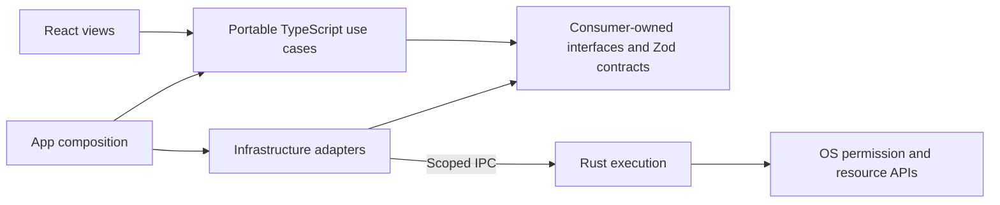

# Movroot architecture

## Implemented foundation

Movroot is a single Tauri 2 desktop app. It renders a bundled React screen with the Movroot name. Zod is available for future TypeScript runtime contracts. The desktop identifier is `app.movroot.desktop`. Installed builds load local assets and run as a standard user.



The graph describes intended feature dependencies. The current shell has no product use cases or adapter implementations. Future feature UI and application logic go under `src/features/<feature>/ui/` and `application/`. Shared models and contracts can move to `src/core/`. Concrete device, AI, and persistence adapters belong in `src/infrastructure/`. Keep unit tests beside their modules and add integration fixtures under `tests/` or `src-tauri/tests/` when needed. Native command handlers should delegate to Rust modules grouped by operation. Isolate OS differences beside the native operation. Use Kotlin or Swift when a future mobile capability needs it.

ESLint restricts static imports from portable code into React, Node, Tauri, composition, and infrastructure. Feature views cannot import Tauri or concrete infrastructure. Composition can instantiate implementations and infrastructure can import consumer-owned interfaces. There are no configured import aliases. Review indirect dependencies and cycles during code review.

## Trust boundaries

The webview and TypeScript request work. User approval expresses intent and Zod validates data shape. Rust independently authorizes operations using OS permissions, native grants, and current resource state. Provider responses and file contents are untrusted data.

- The local main capability grants zero IPC permissions. No application commands or external plugins are registered. The production CSP restricts content to bundled assets and forbids outbound connections, frames, and objects. Development uses a separate policy for loopback Vite and HMR. The native window enforces the configured origin and denies new windows.
- Future native grants must constrain the resource and operation. Reject traversal, out-of-scope symlinks and reparse points, and stale grants. Recheck identity and expected state at execution time, including after approval. Default to no overwrite and honor destination filesystem rules.
- Bound file reading, decompression, and parsing. Keep prompt injection and untrusted structured output away from command execution and authority decisions. Require informed consent and minimize data sent externally. Keep credentials and raw content out of logs.
- Before adding filesystem mutation, implement durable operation intent and outcomes, source and destination checks, and reconciliation after interruption. A database transaction cannot make a filesystem operation atomic. Verify destinations before deleting sources in cross-volume workflows.

## Planned integrations

Device adapters use opaque IDs, normalized metadata, and explicit per-item capabilities. IDs need not be paths or permanently valid. Desktop implementations can share Rust logic. Mobile providers may have revocable grants, incomplete metadata, and streaming-only access. Start with read-only discovery.

Muse Ember is the intended first AI provider. A provider adapter constructs payloads, validates structured output using Zod, normalizes errors, and exposes reported usage. Native transport owns endpoint and redirect policies, credentials, cancellation, timeouts, and size limits. Installed credentials belong in OS secure storage. Use ignored local environment files for future native development credentials. Keep credentials out of frontend variables and distributed binaries.

SQLite is planned for settings, metadata, analysis, proposals, history, and undo or recovery state. Select bindings and schema with the first durable use case. File discovery, mutation, AI, persistence, authentication, mobile integration, background agents, and updates are outside initialization.

## Development and verification

Use the version in `.node-version` and npm `11.19.1` bundled with that release. Install rustup and use the repository's `rust-toolchain.toml`. On macOS install Apple Command Line Tools. On Windows use x64 MSVC C++ Build Tools, the Windows SDK, and WebView2. Activate a project-local or user-level Node installation before running the commands.

```sh
npm ci
npm run typecheck
npm run lint
npm run format:check
npm test
npm run build
cargo fmt --manifest-path src-tauri/Cargo.toml --all -- --check
cargo test --locked --manifest-path src-tauri/Cargo.toml
npm run tauri -- build --no-bundle -- --locked
npm run tauri -- dev
```

GitHub Actions verifies macOS ARM64 and Windows x64. CI compilation, installer generation, installation, and successful launch are separate checks. The initial Apple Silicon packaging command is:

```sh
APPLE_SIGNING_IDENTITY=- npm run tauri -- build --target aarch64-apple-darwin --bundles dmg -- --locked
```

The DMG is unsigned and its app is ad-hoc signed. Verify with `hdiutil verify`, mount, copy to a fresh user-writable location, eject, and launch with Vite stopped. Use `lipo -archs` to check the executable. For distribution, build a universal DMG on macOS and an x64 NSIS installer on Windows. Test clean client machines, including WebView2 availability, Intel Mac launch, Gatekeeper, and SmartScreen. Production signing, notarization, publication, and minimum supported OS versions are deferred.

## Initialization verification

The pinned direct dependencies are in `package.json` and `src-tauri/Cargo.toml`. Registry metadata was checked before installation. ESLint 10.15.0 and typescript-eslint 8.74.0 replace the initially evaluated 10.5.0 and 8.72.1 because the updated versions cleared the npm audit advisories without changing the supported TypeScript range. Both lockfiles are included as source inputs. The npm lockfile includes macOS ARM64 and Windows x64 native dependency entries. No global package install or shell profile change was needed on the development host.

- Apple Silicon, macOS 26.6.2: clean npm install, lint, formatting, TypeScript, React smoke test, frontend production build, Rust formatting and origin test, and native release compilation passed. Eleven representative ESLint boundary cases passed through stdin. The native development window rendered the Movroot heading from loopback Vite.
- The regular DMG command reached ad-hoc app signing, then Finder timed out customizing the disk image. Rebundling the ARM64 build with `CI=true APPLE_SIGNING_IDENTITY=- npm run tauri -- bundle --target aarch64-apple-darwin --bundles dmg` produced the unsigned DMG. Its checksum, mount, copy, eject, ARM64 executable, code signature, and installed launch passed. The successful copy used a fresh temporary installation directory outside the workspace's File Provider location. The installed window rendered from `tauri://localhost` with the Vite port closed.
- The Rust test exercises the release and development origin checks. New-window denial and the empty IPC capability were inspected in code and configuration. A standalone browser-level denial test remains unverified.
- GitHub Actions records the macOS ARM64 and Windows x64 build results for each commit. Windows x64 runtime behavior, Intel compatibility, and public distribution remain unverified. Standalone webview denial checks are deferred to the relevant native integration milestones.
