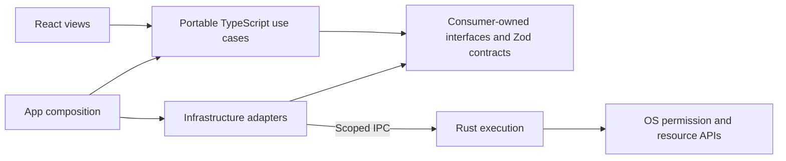

# Movroot architecture

## Implemented foundation

Movroot is a single Tauri 2 desktop app. It renders bundled React views for device access and synthetic inference. Zod validates TypeScript runtime contracts. The desktop identifier is `app.movroot.desktop`. Installed builds load local assets and run as a standard user.



The device and inference features use these dependencies. Future feature UI and application logic go under `src/features/<feature>/ui/` and `application/`. Shared models and contracts can move to `src/core/`. Concrete device, AI, and persistence adapters belong in `src/infrastructure/`. Keep unit tests beside their modules and add integration fixtures under `tests/` or `src-tauri/tests/` when needed. Native command handlers should delegate to Rust modules grouped by operation. Isolate OS differences beside the native operation. Use Kotlin or Swift when a future mobile capability needs it.

ESLint restricts static imports from portable code into React, Node, Tauri, composition, and infrastructure. Feature views cannot import Tauri or concrete infrastructure. Composition can instantiate implementations and infrastructure can import consumer-owned interfaces. There are no configured import aliases. Review indirect dependencies and cycles during code review.

## Trust boundaries

The webview and TypeScript request work. User approval expresses intent and Zod validates data shape. Rust independently authorizes operations using OS permissions, native grants, and current resource state. Provider responses and file contents are untrusted data.

- The local main capability grants scoped device commands, inference credential settings, synthetic inference, and cancellation. The native dialog Rust plugin is registered without any frontend dialog grant. Its transitive filesystem plugin is not registered. The production CSP permits bundled content and the Tauri IPC transport only, and forbids frames and objects. Development uses a separate policy for loopback Vite and HMR. The native window enforces the configured origin and denies new windows.
- Future native grants must constrain the resource and operation. Reject traversal, out-of-scope symlinks and reparse points, and stale grants. Recheck identity and expected state at execution time, including after approval. Default to no overwrite and honor destination filesystem rules.
- Bound file reading, decompression, and parsing. Keep prompt injection and untrusted structured output away from command execution and authority decisions. Require informed consent and minimize data sent externally. Keep credentials and raw content out of logs.
- Before adding filesystem mutation, implement durable operation intent and outcomes, source and destination checks, and reconciliation after interruption. A database transaction cannot make a filesystem operation atomic. Verify destinations before deleting sources in cross-volume workflows.

## Planned integrations

Device adapters use opaque IDs, normalized metadata, and explicit per-item capabilities. IDs need not be paths or permanently valid. Desktop implementations can share Rust logic. Mobile providers may have revocable grants, incomplete metadata, and streaming-only access. Start with read-only discovery.

SQLite is planned for settings, metadata, analysis, proposals, history, and undo or recovery state. Select bindings and schema with the first durable use case. File discovery and reading are implemented in M1. Mutation, AI, persistence, authentication, mobile integration, background agents, and updates are outside M1.

## Development and verification

Use the version in `.node-version` and npm `11.19.1` bundled with that release. Install rustup and use the repository's `rust-toolchain.toml`. On macOS install Apple Command Line Tools. On Windows use x64 MSVC C++ Build Tools, the Windows SDK, and WebView2. Activate a project-local or user-level Node installation before running the commands.

```sh
npm ci
npm run typecheck
npm run lint
npm run format:check
npm test
npm run build
cargo fmt --manifest-path src-tauri/Cargo.toml --all -- --check
cargo test --locked --manifest-path src-tauri/Cargo.toml
npm run tauri -- build --no-bundle -- --locked
npm run tauri -- dev
```

GitHub Actions verifies macOS ARM64 and Windows x64. CI compilation, installer generation, installation, and successful launch are separate checks. The initial Apple Silicon packaging command is:

```sh
APPLE_SIGNING_IDENTITY=- npm run tauri -- build --target aarch64-apple-darwin --bundles dmg -- --locked
```

The DMG is unsigned and its app is ad-hoc signed. Verify with `hdiutil verify`, mount, copy to a fresh user-writable location, eject, and launch with Vite stopped. Use `lipo -archs` to check the executable. For distribution, build a universal DMG on macOS and an x64 NSIS installer on Windows. Test clean client machines, including WebView2 availability, Intel Mac launch, Gatekeeper, and SmartScreen. Production signing, notarization, publication, and minimum supported OS versions are deferred.

## Initialization verification

The pinned direct dependencies are in `package.json` and `src-tauri/Cargo.toml`. Registry metadata was checked before installation. ESLint 10.15.0 and typescript-eslint 8.74.0 replace the initially evaluated 10.5.0 and 8.72.1 because the updated versions cleared the npm audit advisories without changing the supported TypeScript range. Both lockfiles are included as source inputs. The npm lockfile includes macOS ARM64 and Windows x64 native dependency entries. No global package install or shell profile change was needed on the development host.

- Apple Silicon, macOS 26.6.2: clean npm install, lint, formatting, TypeScript, React smoke test, frontend production build, Rust formatting and origin test, and native release compilation passed. Eleven representative ESLint boundary cases passed through stdin. The native development window rendered the Movroot heading from loopback Vite.
- The regular DMG command reached ad-hoc app signing, then Finder timed out customizing the disk image. Rebundling the ARM64 build with `CI=true APPLE_SIGNING_IDENTITY=- npm run tauri -- bundle --target aarch64-apple-darwin --bundles dmg` produced the unsigned DMG. Its checksum, mount, copy, eject, ARM64 executable, code signature, and installed launch passed. The successful copy used a fresh temporary installation directory outside the workspace's File Provider location. The installed window rendered from `tauri://localhost` with the Vite port closed.
- The Rust test exercises the release and development origin checks. New-window denial and the empty IPC capability were inspected in code and configuration. A standalone browser-level denial test remains unverified.
- GitHub Actions records the macOS ARM64 and Windows x64 build results for each commit. Windows x64 runtime behavior, Intel compatibility, and public distribution remain unverified. Standalone webview denial checks are deferred to the relevant native integration milestones.

## M1.1 device access checkpoint

The main webview can invoke `select_device_scope({ request: {} })` and `clear_device_scope({ request: { scopeId } })`. At the M1.1 checkpoint, the native picker is parented to the requesting window. Rust accepts the picker result, validates the root, and publishes an opaque UUID with a display label and an empty operation-capability list. The adapter validates the result with Zod and normalizes errors. It keeps native paths and handles outside the renderer contract.

Rust holds one active grant and one pending picker ticket per main webview session. Selection cancellation keeps the existing grant. Successful replacement revokes the old ID. Clear requires the expected ID and invalidates in-flight replacement. Native navigation and page-start events revoke the grant and disable admission until the page finishes loading. A late picker completion cannot restore a revoked scope. The native worker opens the folder outside the state lock, and a worker join failure releases its picker ticket. The grant is in-memory and the owned handle closes on revocation or exit.

The macOS implementation opens directory components relative to descriptor handles without following symlinks. It accepts ordinary local APFS paths and filters known cloud roots, dataless entries, and broad locations. The Windows implementation walks a local fixed NTFS drive with handle-relative NT opens, rejects reparse and recall attributes, and uses owning Rust handles. API access flags and bounded UTF-16 names are checked in the Windows module. The scope authorizes the pinned directory object, including after a rename or move. Its display label may become stale. Relative access stays on the pinned directory, even if a different directory takes its former path. Replacement or revocation invalidates the previous identifiers. The picker supplies a path, which leaves a residual interval between selection and acquiring the handle. These checks are not a filesystem snapshot or a comprehensive provider detector. No filesystem content is opened by the M1.1 commands.

M1.1 adds the Tauri JavaScript invoke API, the Rust dialog plugin, Serde and UUID for narrow contracts and identifiers, rustix for macOS descriptor-relative calls, and windows-sys for the Windows handle APIs. The macOS unit tests cover grant replacement, clear during a pending picker, reload, cancellation, replay, and handle-relative lookup and replacement. The packaged macOS app selected and cleared a synthetic scope, and the development webview exercised native picker cancellation. TypeScript adapter tests cover cancellation, response shape and error normalization. The Windows FFI module and native probe tests type-checked for x64 MSVC in isolation. Running those tests requires Windows. The full app cross-check on macOS stopped at the Windows resource compiler.

The M1.1 Windows filesystem gate passed on the Windows x64 runner, including native enumeration, relative opens, directory replacement and file replacement, junction and out-of-scope rejection, handle cleanup, and the complete Tauri build. M1.2 adds bounded immediate-directory discovery. Both M1.2 CI jobs passed. The packaged macOS app listed a synthetic fixture. Interactive Windows verification and behavioral denial checks for unauthorized invokes and popups remain open.

## M1.2 discovery

`discover_device_files` lists eligible immediate regular files through the pinned root handle. `cancel_device_operation` addresses the live operation or the next sequential request on the active scope. The native session retains one worker, one bounded listing and one bit for cancellation arriving before admission. Scope replacement and revocation invalidate the IDs and signal the worker. The two-second deadline is cooperative.

Each scan examines at most 2,000 entries, returns at most 500 files, and caps the serialized response at 512 KiB. Listing IDs are regenerated on successful refresh. Metadata supplies names, optional extensions and sizes. Missing fields remain optional. Results distinguish complete, partial, truncated and cancelled scans. The React screen requests discovery explicitly and drops stale responses. No scan reads file content.

## M1.3 bounded reads and previews

`read_device_file` accepts a scope ID, listing file ID, sequential request ID, mode and byte cap. It admits at most one worker before scheduling blocking I/O, shares cancellation with discovery, and rejects stale resources. The native read is bound to the authorized directory handle and verifies file identity and metadata before and after reading. It rejects links, non-regular files, multiply linked files and changed resources. These checks detect ordinary replacement and concurrent modifications. They are not snapshot semantics. The three-second budget is cooperative and cannot force an OS call or decoder to return.

The native input cap is 8 MiB. Explicit preview requests accept PNG and JPEG signatures, limit dimensions to 4,096 pixels per axis and 8 megapixels, and use a best-effort 64 MiB decoder budget. Rust returns an encoded PNG thumbnail of at most 512 pixels per side and 2 MiB. The renderer displays a Blob URL scoped by `img-src` and revokes it on replacement, refresh, clear or unmount. No original image is rendered directly, and preview work starts only on request.

The Tauri binary response is validated as an ArrayBuffer before the adapter yields portable bytes. A temporary packaged WKWebView experiment returned the exact four synthetic bytes and a structured limit error with a three-byte cap. Array-shaped responses are rejected, including the Tauri JSON fallback. No fallback is configured. Windows WebView2 and Windows installation are unverified pending an interactive Windows host.

### M1 verification

The implementation at `0d464c96ebfd78e5eccc3344069ba0c9fb4e7053` passed [macOS ARM64 and Windows x64 CI](https://github.com/abishek1303/movroot/actions/runs/45427726548). The Windows filesystem gate executed and passed on Windows. Both jobs passed the full Rust suite and native Tauri compilation. The local macOS suite passed five TypeScript tests and ten Rust tests.

The macOS development webview rendered a generated PNG thumbnail and rejected an unsupported file with a PNG extension. The Apple Silicon DMG passed its integrity check. The app was copied from the mounted image, the image was ejected, and the copied ARM64 app launched with Vite stopped. Its packaged webview discovered the synthetic fixture, rendered a thumbnail generated from JPEG, and removed the preview on clear. The exact-byte IPC probe was run separately in a temporary packaged build. Windows interactive picker, WebView2 byte representation, installer and launch checks remain pending.

## M2 synthetic inference

The portable inference use case owns session admission, result lifetimes and cumulative estimates. App composition wires a Muse Ember adapter and native transport into the diagnostic panel. The provider adapter builds requests, validates structured responses and normalizes usage. Device discovery, file reads and previews have no path into inference. Inference output cannot trigger native actions. The [Meta API reference](docs/meta-api.md) records the wire format, diagnostics and pricing.

Rust accepts only the two bundled examples and their versioned prompt and response schema. Native transport owns the fixed HTTPS endpoint, deadlines and byte limits. macOS Keychain and Windows Credential Manager store the credential by application identity. Native credential resolution exposes only the source to the renderer and supplies the key to native transport. Debug Tauri development resolves a nonempty native `META_API_KEY`, then the repository-local `.env`, then the OS vault. Packaged builds use the vault exclusively. Environment credentials are never persisted by the resolver. One shared lease serializes credential operations with inference, and navigation revokes the current session. Request IDs scope cancellation to the active or next sequential request. The ten-dispatch process limit survives reload and credential replacement. The renderer separately stops initiating work once reported estimates reach the diagnostic spending threshold.

M2 passed lint, formatting, TypeScript type checking, the frontend build, 21 TypeScript tests and 17 macOS Rust unit tests. Two focused Rust tests also passed with the bundled asset protocol enabled. Vite denied direct access to `.env`. On macOS, the Tauri development webview resolved the configured development credential and completed one live synthetic request per modality. The [Meta API reference](docs/meta-api.md) records observed usage. The local arm64 debug bundle loaded bundled assets and displayed its normal key-entry workflow with both a repository dotenv file and a dummy process key present. Secure-store save and removal, a release-profile installer, Windows runtime behavior, and billing reconciliation remain pending.

## M3 semantic file analysis

The discovery screen accepts up to five selected IDs. An explicit local check reuses the pinned device scope, current listing, scoped reader and cancellation. Rust retains one in-memory preparation plan and returns a metadata manifest. The native confirmation lists each eligible file and the prepared data Meta will receive. It replaces unsafe display characters without changing resource identity. A two-minute review grant and a five-minute approved dispatch window bind the exact prepared content to the current window session, scope, listing, and bundled Ember analysis configuration. Each item is single-use. Clear, replacement, refreshed discovery, navigation, expiry and cancellation revoke the plan. Native code reopens and checks resource state before dispatch. These checks do not provide filesystem snapshot semantics.

PNG and JPEG are recognized by content and decoded under the 8 MiB source ceiling, 4,096 pixels per axis, 8 megapixels and a best-effort 64 MiB decoder budget. Static images retain their full frame, apply decoder-supported orientation, and are re-encoded without source metadata. Analysis images start at up to 2,560 pixels on the long edge with 2,048 and 1,600 pixel fallback targets and a 2 MiB encoded limit. M1 preview remains a separate operation. UTF-8 text, Markdown, JSON and CSV use an allowlisted suffix after byte checks, accept an optional BOM, normalize line endings and submit up to 16 KiB with original coverage and normalized byte counts. JSON is parsed locally up to 256 KiB. CSV is literal source with no dialect validation. PDF, audio, video, archives, executables, and Office documents are deferred.

TypeScript owns serial batch scheduling, Zod validation, presentation versus semantic classification, filename proposals and usage accounting. Rust owns consent, content preparation, bounded request construction and execution. There is one active provider request, with a shared native process default of 20 dispatches, a startup policy ceiling of 30, and a native rate-limit cooldown. File-analysis session estimates and provisional reserves are shown separately. The default local threshold is $0.01 and the initial provisional reserve is $0.002912. Synthetic diagnostics retain their separate estimated spending display and share the native dispatch admission.

The local macOS implementation checkpoint passed TypeScript, lint, formatting, 25 TypeScript tests, 21 Rust tests and a native release build without bundling. A fake IPC transport exercised a priced semantic result, and native synthetic fixtures exercised preparation and rejection of unapproved, replayed and stale dispatches. Comprehensive adversarial testing, live semantic output quality, screenshot readability, billing reconciliation, Windows runtime and packaged verification remain pending.

### M3 targeted local verification

The macOS development workflow discovered seven synthetic files in a temporary folder, rendered an existing image preview, prepared five supported files, and excluded a malformed PNG and a deferred PDF. The native review showed the eligible names, image re-encoding, dimensions, text excerpt coverage, provider, and charge notice. A controlled decline left the native attempt count unchanged. An earlier attempted decline sequence was ambiguous and resulted in two synthetic sends. Those sends are included in the five-dispatch total. Environment credential status and refresh worked. Save, replace, and remove remain outside this check.

All five live responses completed at Meta and provided billable token counts. Local semantic validation rejected all five in their sending builds. Field-level diagnostics identified local display bounds on tags, summary, observations, and entities. Bounded normalization now preserves a compact display for these fields. The final correction has offline regression coverage. A development hot update also reset renderer request sequencing and caused a confirmed local rejection; restarting the development app restored sequencing for subsequent checks. The measured usage and cost are recorded in the [Meta API reference](docs/meta-api.md#m3-file-analysis).

The fake transport checks cover no dispatch before approval, after decline or clear, or on replay. Batch tests cover isolation, queued cancellation, accounting on invalid output, and ambiguity. Live screenshot interpretation and source-grounded semantic results require a follow-up before M3.1. Windows, installer behavior, release credential isolation, and provider billing reconciliation remain outside this run.

### M3 staged live retest

A clean development restart and controlled native decline preserved 20 remaining dispatches and zero reservations. The receipt, Markdown, procedural JPEG, and CSV returned useful validated results. On the receipt, the model read the synthetic order ID, date and time, and total. Earlier results remained visible after the second batch, and the long-text failure left the subsequent CSV result usable. All five attempts completed at Meta and reconciled locally for an estimated $0.001555900. [Staged measurements and semantic review](docs/meta-api.md#m3-staged-live-retest)

Sanitized response diagnostics now report normalization by field name. The final correction preserves long and multiple uncertainty notes, deduplicates sensitivity flags and drops oversized filename proposals. Structural checks still reject invalid types, missing fields and unsupported enum values. The earlier Markdown, JPEG, and CSV failures came from local display limits, as did the staged long-text rejection. The exact validation fields for the previous receipt and long-text responses were never captured. No wire schema, prompt or generation setting changed. Hold M3.1 until live verification confirms the corrected long-text path and its caveats.

### Final M3 targeted validation checkpoint

On November 25, 2026, one native-approved macOS development dispatch validated the long-text fixture. Combined with the four useful results from the staged run, this completes M3's targeted functional verification. The long-text result recognized the log and its repeated instruction, expressed uncertainty about the excerpt, and retained the original filename extension. Usage reconciled locally for an estimated $0.000488300. No provider configuration changed. [Checkpoint measurements](docs/meta-api.md#final-m3-long-text-checkpoint)

Semantic response structure is validated independently from processing limits and presentation. The app preserves accepted prose and lists, with expandable previews for ordinary long fields. Uncertainty and sensitivity remain visible in full, with duplicate sensitivity labels collapsed. Native submission metadata supplies source and prepared byte counts, original and transmitted dimensions, and preparation transformations. The UI separates this metadata from labeled model interpretations, including any contradictory coverage statements, without rewriting the model's prose.

Targeted readiness supports M3.1 planning. Windows and packaged verification, credential lifecycle and release isolation, provider billing reconciliation, and comprehensive adversarial and semantic-quality testing remain separate.

### M3.1 original-byte ingestion experiment

Native-approved bare base64 worked for the synthetic PNG, JPEG, and one-page PDF. The PDF result identified both known text and graphical content without local extraction. Bare Markdown was rejected and the same bytes succeeded as a typed `text/plain` inline file. The generic `application/octet-stream` data URL was rejected for the PNG. The seven-dispatch experiment completed in one session with consent and usage reserves intact. [Probe measurements and accounting](docs/meta-api.md#m31-synthetic-original-file-probes)

For production, prefer original-byte submission for supported images and bounded PDFs when local policy and explicit consent allow it. Use content evidence rather than extensions when admission depends on type. Decode text as bounded UTF-8 and send it as `input_text`, keeping parsing out of the semantic path unless a product requirement needs it. Delegate PDF extraction to the provider and disclose the difference between submitted bytes and verified page coverage. Retain local preparation for privacy, safety, compatibility, or resource limits. A change of representation requires fresh consent and a separately accounted request. Model sensitivity flags are advisory. Native privacy controls apply independently. The production refactor has not started.

### M3.1 production ingestion

Production uses one native file plan and three representations. PNG and JPEG default to locally prepared media. The user can select original images before preparing the plan. Original images require supported byte signatures, bounded decoder headers and dimensions, a file terminator, and a 2 MiB maximum. Meta decodes the original payload. Unsupported image formats and animation remain outside the initial policy. Files with other names can be analyzed as bounded UTF-8 text if their bytes pass the text checks. Text ingestion has no required suffix allowlist or JSON parse. Text label hints are derived from suffixes only after admission.

PDF uses bare original bytes through the same provider adapter. Native admission accepts a conservative classic single-subsection cross-reference envelope with at most 64 entries and 256 KiB of source bytes. Encryption markers, escaped names, incremental or hybrid cross-reference indicators, and object streams are excluded. The checks do not validate the page tree, render, decompress, or extract local PDF content. Provider-side parsing can still reject malformed objects. The manifest states that all approved bytes will be submitted and that PDF page coverage is uncertain. The PDF in-flight reserve is $0.006 and retains the existing accounting rules for unresolved usage. It is a planning allowance rather than a billing ceiling.

The native consent grant covers the exact bytes and representation, with a metadata disclosure for original submissions. Changing image mode invalidates any prepared review. Model sensitivity flags stay advisory. Five files per batch and sequential inference remain in place. The synthetic-only selector and native probe branches were removed. Findings and cumulative experimental spend and reserves remain in the Meta API reference.

Offline macOS verification passed 25 Rust and 30 TypeScript tests, type checking, lint, formatting, the frontend production build, and the native release check. The release check reported the existing unused development-only dotenv dependency warning. Broader PDF coverage and Windows runtime behavior remain unverified.

### M3.1.5 Slice 1 desktop workflow

The application shell presents Organize and History as local views. The Organize subtree stays mounted when hidden so its existing discovery and analysis owners retain pending operations, results, and cancellation handles. The composition root retains the file-analysis workflow and cumulative usage across folder and tab changes. Native picker approval starts bounded local discovery. File preparation and native consent remain separate from discovery. Review projects validated results over immediate discovered files using a replaceable category mapping and supports inspection only. History has an empty state until durable operation records exist. The shell uses semantic CSS tokens and system appearance with a Lavender accent. Appearance customization, animation, discovery contract changes, and batch scaling are deferred.

Slice 1 verification passed lint, formatting, TypeScript, the production frontend build, 32 Vitest tests, Rust formatting, 25 macOS Rust tests, and the native release-profile check with the custom protocol enabled. The native release check reported the existing unused `dotenvy` warning. An isolated headless browser used fake Tauri responses to exercise tab switches during discovery, local preparation, and inference, declined consent with zero dispatches, and verified the current and proposed review views. Interactive native picker and packaged UI checks on macOS and Windows remain open for this slice.

### M3.1.5 Slice 2 review, appearance, and settings

Review keeps session-local include/exclude choices and destination/name edits keyed by the discovery file ID. The same immutable listing feeds both views. Current shows the original listing, while Proposed projects only included drafts that pass local validation. Selection follows logical folder membership, including collapsed descendants. Blocked, excluded, failed, and unresolved files keep their original location. The category mapper is replaceable. Destination changes are limited to the original folder and available draft categories. Collision checks are conservative and limited to discovered names and draft destinations. The native image preview remains a scoped read of the original file. The review has no execution capability.

Appearance uses versioned, validated webview storage for mode, accent, and reduced motion. CSS resolves system settings and exposes semantic color and motion tokens. Opening either header control leaves the Organize session mounted. Settings initializes provider controls when first opened, and closing it preserves diagnostic state while clearing unsaved credential input. Provider admission and cancellation remain native.

Verification passed 40 Vitest tests, 25 macOS Rust tests, lint, formatting, TypeScript, the production frontend build, Rust formatting, and the native release-profile check. The release-profile check reported the existing unused `dotenvy` warning. The fake-provider browser smoke test verified tab continuity, consent decline, live appearance updates and opening Settings during inference, draft validation and projection, focus restoration, and contrast checks for all 12 light/dark accent combinations. Isolated Chrome keyboard checks exercised Tab, Enter, Space, Page Down, and Escape, and live system appearance and motion changes. Packaged WKWebView and WebView2 checks remain open.

To run the standalone browser smoke test, serve this checkout with `npm run dev -- --port 5174` and open `/tests/slice2-browser.html` on that server. The fixture uses in-memory preferences and installs a fake Tauri bridge before loading Movroot. The page title reports the result.

### M3.1.5 Slice 3 motion

The renderer uses pinned GSAP and its React integration for discovery and analysis SVG artwork. The initial folder-selection view remains static. Discovery shows an indeterminate state while the existing scan is pending and reveals a bounded sample from the settled listing. Analysis observes the existing per-file lifecycle callback. Only validated, mapped results appear as destinations, using the same default category mapping as review. Counts, accounting, cancellation, and navigation remain driven by the workflow.

The analysis scene uses eight reusable SVG file glyphs and a one-frame buffer that keeps the latest event per file. The scene drops surplus events when its glyphs are busy. It renders up to five destination slots and groups overflow visually. MotionPath uses shared SVG viewBox coordinates. Review uses a short Flip transition into the existing draft tree. Tab visibility, reduced motion, cancellation, and cleanup release pending visual work without cancelling analysis. Returning to Organize restores the current scene from the results. Animation never gates progress or review.

Verification passed TypeScript, lint, formatting, the production frontend build, 44 Vitest tests, Rust formatting, 25 macOS Rust tests, the native release-profile check, and the isolated macOS Tauri release build. The existing unused `dotenvy` warning remains in the native release check. The standalone fake-provider browser fixture also exercised empty, cancelled, and partial discovery, analysis cancellation and partial failure, consent decline, appearance changes, tab suspension, accounting, and the Flip handoff. Isolated Chromium checks covered resize, theme and motion settings, keyboard navigation, and scrolling. Run the animated portion of the fixture with system motion enabled. No live inference was used.

The isolated build also produced a macOS `Movroot.app` bundle. A separate nonpersistent WKWebView loaded the fake-provider fixture with the production CSP and reached analysis. The background WebKit view reported zero animation frames, so that check did not exercise the GSAP timelines. Installed-app motion on macOS and Windows/WebView2 runtime coverage remain open.

### M3.1.5 final desktop refinement

The Organize view displays the listing count and an extension-based breakdown once. A listing that fits the batch cap defaults to all candidates, and larger listings require a file selection. The primary action prepares the selection and then opens the existing native consent dialog, which shows the actual submission representation. Eligibility still comes from native preparation. The existing budget and provider admission checks remain in the dispatch path.

Start over confirms when there is active work or a populated listing, requests cancellation, waits for the existing operation to settle, and clears the native scope before dropping the folder, manifest, and draft view. A clear failure leaves the folder available for retry. The workflow instance retains cumulative estimates, unresolved reserves, and dispatch restrictions across resets. The confirmation and sticky header remain available independently of the analysis visualization.

Appearance migrates the stored version 1 accent names to the six version 2 presets while preserving mode and motion settings. CSS owns simple press, disclosure, and color transitions. Scoped GSAP effects animate the tab indicator, popover entrance, and stage changes. Settings reports configured credentials separately from a successful diagnostic. Development environment credentials remain authoritative, and the UI offers vault editing only when the vault is the effective source or no key is configured.

TypeScript, lint, formatting, 45 Vitest tests, 25 macOS Rust tests, the production frontend build, native release check, and release application bundling passed. The existing release-profile unused `dotenvy` warning remains. The isolated foreground macOS package opened the real picker, discovered two synthetic files, preselected both, and presented native submission coverage. Declining consent returned to Analyze, and Start over returned focus to Choose folder. A separate foreground WKWebView with production CSP and fake provider replies verified GSAP playback, twelve theme combinations, reduced motion, review, credential editing, and reset after review, during discovery, during preparation, and during inference. It confirmed that in-flight cancellation settles before scope clearing and dispatched reservations survive a reset. Chromium automation also exercised resizing, keyboard focus, scrolling, and appearance controls. Windows runtime and live credential writes remain unverified. The browser fixture's `?reset` option runs the extended reset and credential scenarios.

### M3.1.5 visual polish and analysis recovery

The renderer checks the effective credential through the existing status command before preparing a manifest. A missing key opens the Settings recovery path without preparation, approval, or dispatch. The native approval dialog remains the trusted user action. A renderer-only button or IPC flag cannot replace it under the current trust model. A future single-action design could prepare locally and put a manifest-aware Analyze control in trusted native UI, issuing the current one-use approval only from that control.

The active view measures settled work and reports successful, failed, skipped, cancelled, and processing counts separately. Settlement stops the scene and replaces the progress bar with the result summary. Retry uses only retryable file IDs from the last batch and preserves earlier results and accounting. Discovery and analysis share gradient SVG glyphs, with the same eight motion slots and per-frame coalescing. Appearance separates dark action fills with white labels from brighter artwork tokens.

Type checking, lint, formatting, 45 Vitest tests, 25 Rust tests, production frontend build, native release check, and isolated macOS app bundling passed. Foreground WKWebView under the production CSP verified all twelve theme combinations, motion, missing-key preflight without dispatch, native-approval IPC flow with fake replies, cancellation, retained reserves, retry selection, full and partial completion, and read-only review. The packaged macOS app picked four local synthetic files, showed the correct type breakdown, and opened Settings from its real missing-key state without dispatch. Windows runtime remains unverified. Vite reported a roughly 504 kB minified application chunk, and the existing native release-profile `dotenvy` warning remains.

### Discover, Analyze, Organize presentation

Discover presents the native listing, known aggregate size, format distribution, and selectable file browser. Analyze begins after native approval, keeps a stable eligible-batch list, and distinguishes validated success from settled work. Its category filters reuse the existing classification mapping. Organize renders only the projected destination tree, with original names and locations in the inspector. Counts for moves and renames overlap where appropriate. All proposal changes remain read-only.

The three stages share a filesystem viewport and search controls. File lists render at most 80 leaves per page, format and category breakdowns show at most six groups before overflow, and image previews remain explicit native reads. Folder selection in the proposal uses full descendants across filtered and paged views. GSAP animates stage changes, distribution updates, disclosures, and the proposal handoff. Numeric totals remain driven by real state. The renderer uses the existing native picker, consent, cancellation, and provider adapters with the same processing caps.

Type checking, lint, formatting, 45 Vitest tests, 25 Rust tests, frontend build, native release check, and isolated macOS application bundling passed. Foreground macOS WKWebView with production CSP and fake provider replies verified 500 synthetic discovery entries, the 80-row page cap, eight format groups, format and category filters, contextual preview, dock bounds at 920 × 720 and 620 × 580, cancellation and retry, appearance, and draft editing in the proposed-only tree. The macOS app bundle was built separately. Windows runtime remains unverified. The existing release-profile `dotenvy` warning and Vite's 500 kB chunk warning remain.

Discover now keeps folder actions in an overflow popover. Its action group sits in a reserved row below the independently scrolling file list. Budget, original-image handling, and usage estimates are available through the Analysis options icon. Native approval remains the point where the exact submission and potential charges are disclosed. Foreground WebKit with fake provider responses verified the compact layout, Escape focus restoration, and the existing three-stage workflow.
